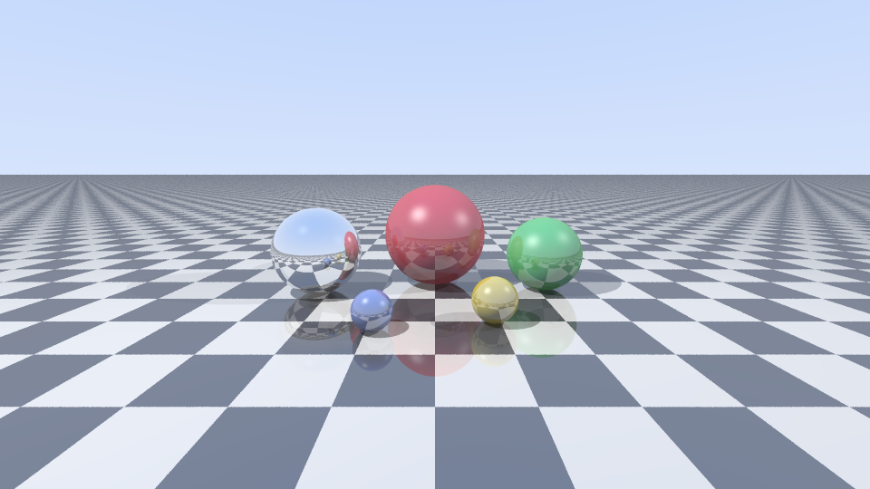

# 🔆 Ray Tracer em C++17

Um ray tracer feito do zero em C++ moderno, **sem nenhuma dependência externa**.
Renderiza uma cena 3D com reflexos, sombras e anti-aliasing, usando todos os núcleos da CPU.



## ✨ Features

- Esferas e plano infinito com padrão xadrez
- Iluminação **Blinn-Phong** (ambiente + difusa + especular)
- **Sombras** com múltiplas fontes de luz
- **Reflexos recursivos** (espelhos, até 5 rebatidas)
- **Anti-aliasing** por supersampling aleatório
- **Multithreading** com `std::thread` e distribuição dinâmica de linhas
- Correção gama e saída em formato PPM

## 🚀 Como compilar e rodar

Com CMake:

```bash
cmake -B build -DCMAKE_BUILD_TYPE=Release
cmake --build build
./build/raytracer
```

Ou direto com g++:

```bash
g++ -std=c++17 -O3 -pthread src/main.cpp -o raytracer
./raytracer
```

### Argumentos

```bash
./raytracer [largura] [altura] [amostras_por_pixel] [arquivo_saida]
./raytracer 1920 1080 64 hd.ppm
```

O arquivo `.ppm` abre no GIMP, IrfanView, VS Code (extensão) ou pode ser convertido com
`convert render.ppm render.png` (ImageMagick).

## 🗂️ Estrutura

```
src/
├── vec3.hpp    # Vetor 3D e operações (dot, cross, reflect...)
├── scene.hpp   # Ray, Material, Sphere, Plane, Light, Scene
└── main.cpp    # Câmera, trace recursivo, threads e saída
```

## 🧠 Como funciona

1. Para cada pixel, a câmera dispara um raio pela cena.
2. Acha-se a interseção mais próxima (esfera ou plano).
3. Para cada luz, dispara-se um raio de sombra e calcula-se o brilho Blinn-Phong.
4. Se o material é refletivo, o raio é refletido e o processo se repete recursivamente.
5. As cores das amostras são médias e passam por correção gama.

## 💡 Ideias para evoluir

- [ ] Refração (vidro/água) com Lei de Snell e Fresnel
- [ ] Carregar modelos `.obj` com triângulos + BVH
- [ ] Path tracing com iluminação global
- [ ] Texturas e normal maps
- [ ] Depth of field (profundidade de campo)
- [ ] Saída direta em PNG

## 📄 Licença

MIT
